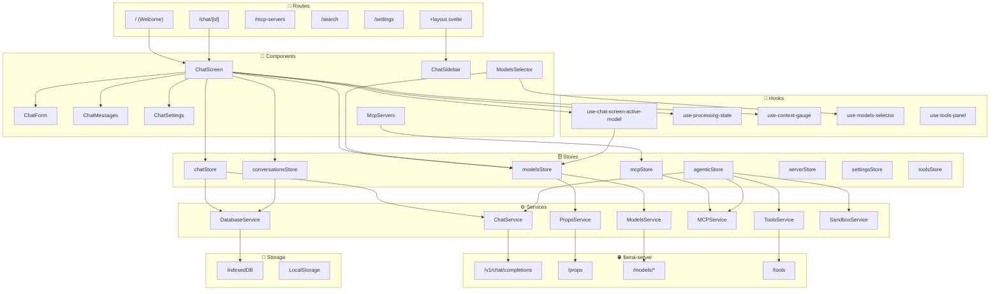
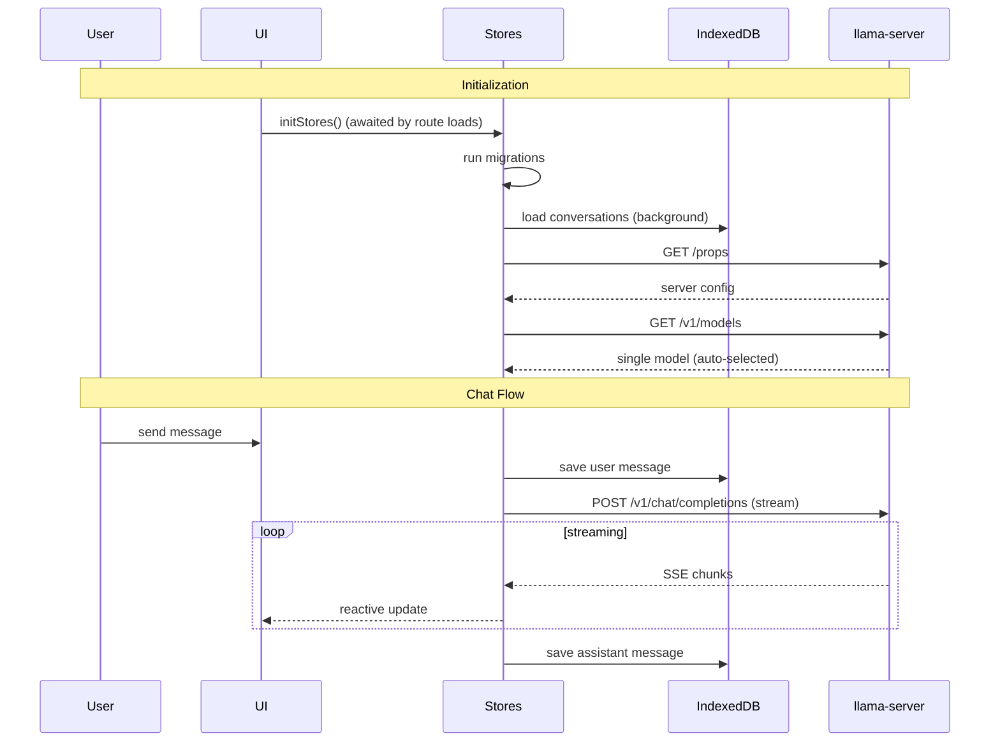
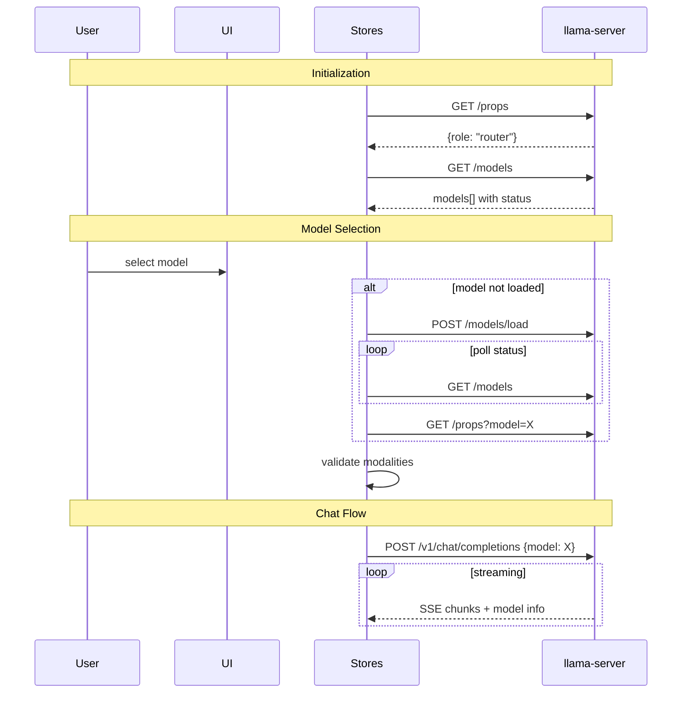
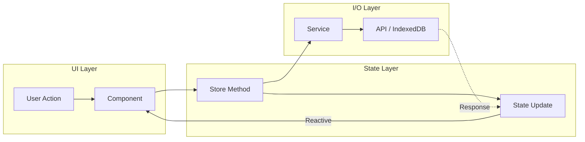
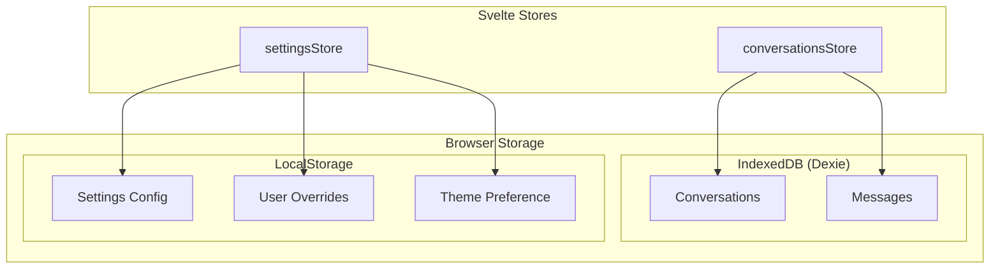

# chatbot-webui

A standalone chat web UI for any OpenAI-compatible API. Forked from the
[llama.cpp](https://github.com/ggml-org/llama.cpp) web UI (`tools/ui`) and
modified so the backend is fully configurable — point it at llama.cpp, vLLM,
Ollama, LM Studio, or any gateway by changing one setting. No llama.cpp
backend required to run this.

Built with SvelteKit 2 + Svelte 5 (runes), served as a static SPA (PWA).

## Quick start

```bash
npm ci
npm run build          # static output in dist/
API_TARGET=http://192.168.100.4:8080 npm run serve
# open http://localhost:5173
```

`npm run serve` is a tiny dependency-free server (`server.mjs`) that serves
`dist/`, proxies the API paths (`/v1/*`, `/props`, `/models`, `/slots`,
`/tools`) to `API_TARGET` under the same origin, and hosts the **SQLite
storage** (see below). This works with _any_ backend, even ones that send no
CORS headers (plain python servers, embedded devices…). It accepts a bare
origin or an OpenAI-style `/v1` base URL.

Environment for `serve`: `PORT` (default 5173), `HOST` (default 0.0.0.0),
`API_TARGET` (default `http://localhost:8080`), `DB_PATH` (SQLite file,
default `chatbot-webui.db` next to `dist/`; `:memory:` for ephemeral).

## System prompt library

The UI keeps a **library of named system prompts** stored in the same SQLite
database, instead of one global prompt. A picker sits in the chat bar (left of
the model selector): choose which prompt new chats start with, or **None** to
start without one. The menu also adds/edits/deletes prompts and marks the
default (star).

- The selected prompt is baked into each new conversation as its system
  message — edit it inline in the chat afterwards if you want a per-chat
  tweak; the library entry stays untouched.
- The old Settings → "System Message" field still works, but only when the
  picker is on **None** (legacy fallback).
- Prompts sync across browsers/devices like everything else (`/api/db`).

## Storage: server-side SQLite (not the browser)

Conversations, messages and settings live in a real **SQLite database on the
server** (`node:sqlite`, no native dependencies), not in the browser's
IndexedDB/localStorage. Your chat history follows you to any browser or
device that loads the same deployment, survives browser resets, and is
backed up by copying one file.

- The database is `chatbot-webui.db` (WAL mode) next to `dist/`; move it with
  `DB_PATH=/path/to/db.sqlite`. Row counts: `GET /api/db/stats`.
- **First-launch migration:** if the server database is empty and this
  browser still holds conversations in IndexedDB (from an older llama-ui
  visit), they are uploaded once automatically. The IndexedDB copy stays
  untouched for downgrade safety.
- Settings (API URL/key, theme, sampling…) live in the same database and are
  adopted by every browser on startup; localStorage only seeds/mirrors them
  so a stored API key is available before the first network call.
- Fallback: on a static host without the `/api/db` endpoint the UI still
  works for the session (localStorage + in-memory), but nothing persists.

Deploying behind nginx/Caddy instead of `server.mjs`? Reproxy `/api/db` to
the node process as well — or just run `node server.mjs` as the whole app
server; it is production-adequate for a single host.

## Pointing the UI at your API

Three ways, in priority order (highest first):

1. **Settings → General → API URL** (in-app, per browser). Accepts an origin
   (`http://host:8080`) or an OpenAI-style base (`http://host:8080/v1`).
   Leave empty for same-origin. An **API Key** field is right above it — set
   it when your provider requires authentication (sent as a `Bearer` token).

2. **`static/config.js` → `window.DSH_API_ORIGIN`** (per deployment, editable
   after build without rebuilding — just edit `dist/config.js`). Same value
   format; empty = same-origin.

3. **Build-time env**: `VITE_PUBLIC_API_ORIGIN=http://host:8080 npm run build`.

### Cross-origin vs same-origin

The browser only allows cross-origin API calls if the backend sends
`Access-Control-Allow-Origin` for your UI's origin. Many OpenAI-compatible
servers don't (llama-server needs `--cors`; python `http.server` never does).
If the UI shows "Server unavailable" while `curl` works, that's CORS — fix it
with one of:

- `npm run serve` with `API_TARGET=...` (built-in same-origin proxy), or
- put nginx/Caddy in front of both. Caddy example:

  ```caddyfile
  :8081 {
      handle /v1/*  { reverse_proxy backend:8080 }
      handle /props { reverse_proxy backend:8080 }
      handle        { root * dist ; try_files {path} /index.html ; file_server }
  }
  ```

- or enable CORS on the backend itself.

## Backend modes

On startup the UI probes `GET /props`:

- **MODEL / llama.cpp** — full feature set (slots, autoload, per-model props).
- **GENERIC** — `/props` missing (404/405): treated as a plain
  OpenAI-compatible server. Models come from `/v1/models`, and chat requests
  only contain standard OpenAI fields (temperature, top_p, presence/frequency
  penalties, max_tokens, reasoning_effort). Load/unload and llama.cpp-only
  sampling controls are hidden.

## What you keep from the llama.cpp UI

- Streaming chat with markdown, syntax highlighting, thinking/reasoning blocks
- Conversation history (IndexedDB), search, tabs, branching, import/export
- Multimodal input (images, files, PDFs), tool calls, MCP servers
- Model selector, sampling & penalty controls, custom JSON parameters
- Prompt library, file mentions, slash commands, keyboard shortcuts
- PWA: installable, offline shell

## Development

```bash
npm run dev            # vite dev server; proxies API to VITE_PUBLIC_SERVER_ORIGIN (default :9931)
npm run check          # svelte-check
npm test               # unit + e2e suites (from upstream)
```

## Caveats

- **PWA / service worker**: the app precaches its assets, including
  `config.js`. After changing `dist/config.js` or redeploying, do a hard
  refresh (or click the update prompt) — an old cached config keeps pointing
  at the previous API URL.
- The Models management page targets llama.cpp's autoload endpoints; in
  GENERIC mode it lists models but load/unload actions are unavailable.

## Credits

Based on the [llama.cpp](https://github.com/ggml-org/llama.cpp) project's web
UI (MIT license). Upstream license headers are preserved. The upstream
`llama-ui` README sections below document the original architecture in depth.

---

## Upstream documentation (llama-ui)

A modern, feature-rich web interface for llama-server built with SvelteKit. This UI provides an intuitive chat interface with advanced file handling, conversation management, and comprehensive model interaction capabilities.

Llama UI supports two server operation modes:

- **MODEL mode** - Single model operation (standard llama-server)
- **ROUTER mode** - Multi-model operation with dynamic model loading/unloading

---

## Table of Contents

- [Features](#features)
- [Getting Started](#getting-started)
- [Tech Stack](#tech-stack)
- [Build Pipeline](#build-pipeline)
- [Architecture](#architecture)
- [Data Flows](#data-flows)
- [Architectural Patterns](#architectural-patterns)
- [Testing](#testing)

---

## Features

### Chat Interface

- **Streaming responses** with real-time updates
- **Reasoning content** - Support for models with thinking/reasoning blocks
- **Dark/light theme** with system preference detection
- **Responsive design** for desktop and mobile

### File Attachments

- **Images** - JPEG, PNG, GIF, WebP, SVG (with PNG conversion)
- **Documents** - PDF (text extraction or image conversion for vision models)
- **Audio** - MP3, WAV for audio-capable models
- **Text files** - Source code, markdown, and other text formats
- **Drag-and-drop** and paste support with rich previews

### Conversation Management

- **Branching** - Branch messages conversations at any point by editing messages or regenerating responses, navigate between branches
- **Regeneration** - Regenerate responses with optional model switching (ROUTER mode)
- **Import/Export** - JSON format for backup and sharing
- **Search** - Find conversations by title or content

### Advanced Rendering

- **Syntax highlighting** - Code blocks with language detection
- **Math formulas** - KaTeX rendering for LaTeX expressions
- **Markdown** - Full GFM support with tables, lists, and more

### Multi-Model Support (ROUTER mode)

- **Models manager** - one table for every model the server can serve, split into loaded, downloading, favorites, local and hidden sections, with search, context/capability/modality filters, sorting, load/unload, delete from disk and hide. It opens from the sidebar, from a model row or from the selector.
- **Model selector** with Loaded/Available groups
- **Automatic loading** - Models load on selection
- **Modality validation** - Prevents sending images to non-vision models
- **LRU unloading** - Server auto-manages model cache
- **Downloads** - In-flight downloads stay visible above the selector and can be paused, resumed or cancelled from the manager
- **Hub metadata** - Avatars, context length and chat template come from the Hugging Face Hub only while the `Use Hugging Face Hub API for models metadata` setting is on. It is off by default, and the UI then shows what the server reports for `/v1/models`

### Keyboard Shortcuts

| Shortcut           | Action               |
| ------------------ | -------------------- |
| `Shift+Ctrl/Cmd+O` | New chat             |
| `Shift+Ctrl/Cmd+E` | Edit conversation    |
| `Shift+Ctrl/Cmd+D` | Delete conversation  |
| `Ctrl/Cmd+K`       | Search conversations |
| `Ctrl/Cmd+B`       | Toggle sidebar       |

### Developer Experience

- **Request tracking** - Monitor token generation with `/slots` endpoint
- **Storybook** - Component library with visual testing
- **Hot reload** - Instant updates during development

---

## Getting Started

### Prerequisites

- **Node.js** 18+ (20+ recommended)
- **npm** 9+
- **llama-server** running locally (for API access)

### 1. Install Dependencies

```bash
cd tools/ui
npm ci
```

### 2. Start llama-server

In a separate terminal, start the backend server:

```bash
# Single model (MODEL mode)
./llama-server -m model.gguf

# Multi-model (ROUTER mode)
./llama-server --models-dir /path/to/models
```

### 3. Start Development Servers

```bash
npm run dev
```

This starts:

- **Vite dev server** at `http://localhost:5173` - The main UI frontend app
- **Storybook** at `http://localhost:6006` - Component documentation

The Vite dev server proxies API requests to `SERVER_ORIGIN` (with fallback to default llama-server `9931` port):

```typescript
// vite.config.ts proxy configuration
proxy: {
	'/v1': SERVER_ORIGIN,
	'/props': SERVER_ORIGIN,
	'/models': SERVER_ORIGIN,
	'/tools': SERVER_ORIGIN,
	'/slots': SERVER_ORIGIN,
	'/cors-proxy': SERVER_ORIGIN
},
```

### Development Workflow

1. Open `http://localhost:5173` in your browser
2. Make changes to `.svelte`, `.ts`, or `.css` files
3. Changes hot-reload instantly
4. Use Storybook at `http://localhost:6006` for isolated component development

---

## Tech Stack

| Layer             | Technology                      | Purpose                                                  |
| ----------------- | ------------------------------- | -------------------------------------------------------- |
| **Framework**     | SvelteKit + Svelte 5            | Reactive UI with runes (`$state`, `$derived`, `$effect`) |
| **UI Components** | shadcn-svelte + bits-ui         | Accessible, customizable component library               |
| **Drawers**       | vaul-svelte                     | Draggable drawer overlays (mobile pickers, model pane)   |
| **Styling**       | TailwindCSS 4                   | Utility-first CSS with design tokens                     |
| **Database**      | IndexedDB (Dexie)               | Client-side storage for conversations and messages       |
| **Build**         | Vite                            | Fast bundling with static adapter                        |
| **Testing**       | Playwright + Vitest + Storybook | E2E, unit, and visual testing                            |
| **Markdown**      | remark + rehype                 | Markdown processing with KaTeX and syntax highlighting   |

### Key Dependencies

```json
{
	"svelte": "^5.0.0",
	"bits-ui": "^2.8.11",
	"dexie": "^4.0.11",
	"pdfjs-dist": "^5.4.54",
	"highlight.js": "^11.11.1",
	"rehype-katex": "^7.0.1"
}
```

---

## Build Pipeline

### Development Build

```bash
npm run dev
```

Runs Vite in development mode with:

- Hot Module Replacement (HMR)
- Source maps
- Proxy to llama-server

### Production Build

```bash
npm run build
```

The build process:

1. **Vite Build** - Bundles all TypeScript, Svelte, and CSS
2. **Static Adapter** - Outputs to `../../build/tools/ui/dist` (llama-server's static file directory)
3. **Post-Build Script** - Cleans up intermediate files
4. **Custom Plugin** - Creates `index.html` with:
   - Inlined favicon as base64
   - GZIP compression (level 9)
   - Deterministic output (zeroed timestamps)

```text
tools/ui/        →  build  →  build/tools/ui/dist/
├── src/                                 ├── index.html  (served by llama-server)
├── static/                              └── (favicon inlined)
└── ...
```

### SvelteKit Configuration

```javascript
// svelte.config.js
adapter: adapter({
  pages: '../../build/tools/ui/dist',      // Output directory
  assets: '../../build/tools/ui/dist',     // Static assets
  fallback: 'index.html',  // SPA fallback
  strict: true
}),
output: {
  bundleStrategy: 'inline' // Single-file bundle
}
```

### Integration with llama-server

llama-ui is embedded directly into the llama-server binary:

1. `npm run build` outputs `index.html` to `build/tools/ui/dist/`
2. llama-server compiles this into the binary at build time
3. When accessing `/`, llama-server serves the bundled HTML

This results in a **single portable binary** with the full Llama UI included.

---

## Architecture

Llama UI follows a layered architecture with unidirectional data flow:

```text
Routes → Components → Hooks → Stores → Services → Storage/API
```

### High-Level Architecture



### Layer Breakdown

#### Routes (`src/routes/`)

- **`/`** - Welcome screen, creates new conversation
- **`/chat/[id]`** - Active chat interface
- **`/mcp-servers`** - MCP server management
- **`/search`** - Conversation search
- **`/settings`** - Settings (optional `[[section]]`)
- **`+layout.svelte`** - Sidebar, navigation, global initialization

#### Components (`src/lib/components/`)

Components are organized in `app/` (application-specific) and `ui/` (shadcn-svelte primitives).

**Chat Components** (`app/chat/`):

| Component          | Responsibility                                                              |
| ------------------ | --------------------------------------------------------------------------- |
| `ChatScreen/`      | Main chat container, coordinates message list, input form, and attachments  |
| `ChatForm/`        | Message input textarea with file upload, paste handling, keyboard shortcuts |
| `ChatMessages/`    | Message list with branch navigation, regenerate/continue/edit actions       |
| `ChatAttachments/` | File attachment previews, drag-and-drop, PDF/image/audio handling           |
| `ChatSettings/`    | Parameter sliders (temperature, top-p, etc.) with server default sync       |
| `ChatSidebar/`     | Conversation list, search, import/export, navigation                        |

**Dialog Components** (`app/dialogs/`):

| Component                      | Responsibility                                           |
| ------------------------------ | -------------------------------------------------------- |
| `DialogChatSettings`           | Full-screen settings configuration                       |
| `DialogManageModels`           | Models manager: browse, load, download and delete models |
| `DialogModelInformation`       | Model details (context size, modalities, parallel slots) |
| `DialogChatAttachmentsPreview` | Full preview for images, PDFs (text or page view), code  |
| `DialogConfirmation`           | Generic confirmation for destructive actions             |
| `DialogConversationRename`     | Edit conversation title                                  |

**Server/Model Components** (`app/server/`, `app/models/`):

| Component                           | Responsibility                                                                                                |
| ----------------------------------- | ------------------------------------------------------------------------------------------------------------- |
| `ServerErrorSplash`                 | Error display when server is unreachable                                                                      |
| `ModelsSelector/`                   | Model dropdown and mobile sheet: favorites, loaded and local sections, rows windowed and folded into families |
| `ModelsManager/`                    | Models manager table and model pane: sections, filters, sorting, quants folded per repo, downloads            |
| `ModelAvatar`                       | Org avatar of a model, with the quantizer badge; follows the family grouping of the list                      |
| `ModelId`, `ModelBadge`             | Model name, aliases, tags, quantization and draft sidecar badges                                              |
| `ModelContext`, `ModelCapabilities` | Context window and capability icons, filled from the Hub when it is enabled                                   |

**Shared UI Components** (`app/misc/`):

| Component                                 | Responsibility                                                          |
| ----------------------------------------- | ----------------------------------------------------------------------- |
| `MarkdownContent`                         | Markdown rendering with KaTeX, syntax highlighting, copy buttons        |
| `SyntaxHighlightedCode`                   | Code blocks with language detection and highlighting                    |
| `ActionIcon`, `DropdownMenuActions`       | Reusable action button and action menu                                  |
| `BadgesModality`, `BadgeInfo`             | Status and capability badges                                            |
| `CollapsibleSection`, `CollapsibleRegion` | Section header with a trigger that expands in place                     |
| `GroupedList`                             | Grouped rows with foldable groups, per-group windows and show-more rows |
| `ScrollCarousel`, `TruncatedText`         | Horizontal scroll strip and single-line truncation with tooltip         |

#### Hooks (`src/lib/hooks/`)

Hooks are the thin view-layer between components and stores: they own UI concerns (scroll, drag-and-drop, keyboard shortcuts, pickers, selection) and translate store state into view state.

| Hook                            | Responsibility                                                                                  |
| ------------------------------- | ----------------------------------------------------------------------------------------------- |
| `use-chat-screen-active-model`  | Active model resolution + modality capability detection                                         |
| `use-processing-state`          | View over `chatStore.processing` for streaming progress/tokens                                  |
| `use-context-gauge`             | View over `contextStatsStore` for the context usage gauge                                       |
| `use-models-selector`           | Model selector state: hidden models, family grouping, windowed rows, selection and load on pick |
| `use-tools-panel`               | Tools panel state                                                                               |
| `use-reasoning-menu`            | Reasoning-effort menu state                                                                     |
| `use-attachment-menu`           | Attachment menu + modality flags                                                                |
| `use-draft-messages`            | Per-chat draft message/files persistence                                                        |
| `use-chat-form-pickers`         | Chat form pickers (commands, mentions)                                                          |
| `use-debounced-search`          | Shared debounced async search for pickers                                                       |
| `use-picker-navigation`         | Picker keyboard navigation                                                                      |
| `use-chat-message-edit-context` | Message edit context (content + extras)                                                         |
| `use-chat-screen-drag-and-drop` | Drag-and-drop state machine                                                                     |
| `use-chat-screen-file-upload`   | File upload queue + capability validation                                                       |
| `use-stick-to-bottom`           | Follows new content while the reader sits at the bottom of a scroller                           |
| `use-marquee-selection`         | Shift+click / marquee range selection                                                           |
| `use-keyboard-shortcuts`        | Global keyboard shortcuts                                                                       |
| `use-settings-navigation`       | Settings section navigation                                                                     |
| `use-pwa`                       | PWA install/update + version mismatch detection                                                 |

#### Stores (`src/lib/stores/`)

Stores own reactive application state as Svelte 5 runes. Larger stores are split into directories and compose focused sub-stores behind a narrow host interface (see Architectural Patterns).

| Store                | Responsibility                                                                                                                            |
| -------------------- | ----------------------------------------------------------------------------------------------------------------------------------------- |
| `chatStore`          | Chat lifecycle, streaming, abort control, error handling; composes `processing`, `activity`, `streams`, `flows`                           |
| `conversationsStore` | Conversation CRUD, message branching, navigation, import/export; composes `preferences`                                                   |
| `modelsStore`        | Model list, selection, loading/unloading (ROUTER), recent picks, favorites, hidden models and list open state; composes `props`, `status` |
| `mcpStore`           | MCP host role: multi-server lifecycle, tool routing, server icons; composes `health`, `resources`                                         |
| `agenticStore`       | Multi-turn agentic loop orchestration, tool execution; composes `gates`                                                                   |
| `serverStore`        | Server connection state, `/props`, role detection, modalities                                                                             |
| `settingsStore`      | User preferences, theme, parameter sync with server defaults                                                                              |
| `toolsStore`         | Tool registry: server + MCP tools, enabled set for the LLM                                                                                |
| `permissionsStore`   | Persisted tool permission grants                                                                                                          |
| `contextStatsStore`  | Context window usage for the active conversation                                                                                          |
| `draftMessagesStore` | Per-chat draft message/files                                                                                                              |
| `deviceStore`        | Browser environment signals (mobile, OS, theme)                                                                                           |
| `versionStore`       | Build version information                                                                                                                 |

#### Services (`src/lib/services/`)

Services are a stateless protocol layer: static methods, pure I/O, no reactive state. Stores consume them for all API and storage access.

| Service                       | Responsibility                                                                                                                |
| ----------------------------- | ----------------------------------------------------------------------------------------------------------------------------- |
| `ChatService`                 | `/v1/chat/completions` streaming + SSE parsing, message format conversion                                                     |
| `ModelsService`               | `/models`, `/models/load`, `/models/unload`                                                                                   |
| `PropsService`                | `/props`, `/props?model=`                                                                                                     |
| `HuggingFaceService`          | Hugging Face Hub metadata: model details, avatars, README and file tree, cached per repo and off unless the Hub setting is on |
| `DatabaseService`             | IndexedDB operations via Dexie                                                                                                |
| `MCPService`                  | MCP protocol: transports, connect, list/execute tools, prompts, resources                                                     |
| `ToolsService`                | Server tool list/execute/stream (`/tools`)                                                                                    |
| `SandboxService`              | Browser JS execution in a sandboxed worker                                                                                    |
| `ParameterSyncService`        | Syncs settings with server defaults                                                                                           |
| `ConversationTransferService` | Conversation import/export JSONL + ZIP format                                                                                 |
| `MigrationService`            | Non-destructive localStorage/IndexedDB migrations                                                                             |
| `RouterService`               | Dynamic route URL construction                                                                                                |

---

## Data Flows

### MODEL Mode (Single Model)



### ROUTER Mode (Multi-Model)



---

## Architectural Patterns

### 1. Reactive State with Svelte 5 Runes

All stores use Svelte 5's fine-grained reactivity:

```typescript
// Store with reactive state
class ChatStore {
	#isLoading = $state(false);
	#currentResponse = $state('');

	// Derived values auto-update
	get isStreaming() {
		return $derived(this.#isLoading && this.#currentResponse.length > 0);
	}
}

// Exported reactive accessors
export const isLoading = () => chatStore.isLoading;
export const currentResponse = () => chatStore.currentResponse;
```

### 2. Unidirectional Data Flow

Data flows in one direction, making state predictable:



Components dispatch actions to stores, stores coordinate with services for I/O, and state updates reactively propagate back to the UI.

### 3. Per-Conversation State

Enables concurrent streaming across multiple conversations. Loading is tracked
per conversation by the activity ledger (`chatStore.activity`), while streaming
state and abort controllers live in per-conversation maps:

```typescript
class ChatStore {
	chatStreamingStates = new SvelteMap<string, { response: string; messageId: string }>();
	abortControllers = new SvelteMap<string, AbortController>();
}
```

### 4. Message Branching with Tree Structure

Conversations are stored as a tree, not a linear list:

```typescript
interface DatabaseMessage {
	id: string;
	parent: string | null; // Points to parent message
	children: string[]; // List of child message IDs
	// ...
}

interface DatabaseConversation {
	currentNode: string; // Currently viewed branch tip
	// ...
}
```

Navigation between branches updates `currentNode` without losing history.

### 5. Layered Service Architecture

Stores handle state; services handle I/O:

```text
┌─────────────────┐
│     Stores      │  Business logic, state management
├─────────────────┤
│    Services     │  API calls, database operations
├─────────────────┤
│   Storage/API   │  IndexedDB, LocalStorage, HTTP
└─────────────────┘
```

### 6. Server Role Abstraction

Single codebase handles both MODEL and ROUTER modes:

```typescript
// serverStore.ts
get isRouterMode() {
  return this.role === ServerRole.ROUTER;
}

// Components conditionally render based on mode
{#if isRouterMode()}
  <ModelsSelector />
{/if}
```

### 7. Modality Validation

Prevents sending attachments to incompatible models. The
`use-chat-screen-active-model` hook derives the active model's capabilities
from `modelsStore.props`:

```typescript
// use-chat-screen-active-model hook
const hasVisionModality = $derived.by(() => modelsStore.props.modelSupportsVision(activeModelId));
const hasAudioModality = $derived.by(() => modelsStore.props.modelSupportsAudio(activeModelId));
```

### 8. Persistent Storage Strategy

Data is persisted across sessions using two storage mechanisms:



- **IndexedDB**: Conversations and messages (large, structured data)
- **LocalStorage**: Settings, user parameter overrides, theme, model favorites, recent picks, hidden models and model list open state (small key-value data)
- **Memory only**: Server props, model list (fetched fresh on each session), Hugging Face Hub details (cached per repo for the session)

### 9. Remote Assets Under Cross-Origin Isolation

llama-server serves the UI with `Cross-Origin-Embedder-Policy: require-corp` and `Cross-Origin-Opener-Policy: same-origin`, so a cross-origin subresource has to be allowed by the target origin. The UI handles that per asset kind:

- **Hub avatars** are requested in CORS mode (`crossorigin="anonymous"`), which the Hub allows
- **Hub metadata** is fetched with `fetch()`, which is a CORS request by default, and only while the Hub setting is on
- **MCP server icons and web-search result favicons** have no CORS guarantee, so they go through the server's `/cors-proxy` when the user started llama-server with `--ui-mcp-proxy`; without it they fall back to the bundled glyph
- **Per-row Hub lookups** wait until the row is near the viewport (the `nearViewport` action), so a long model list does not fire one request per row on mount

---

## Testing

### Test Types

| Type          | Tool               | Location         | Command             |
| ------------- | ------------------ | ---------------- | ------------------- |
| **Unit**      | Vitest             | `tests/unit/`    | `npm run test:unit` |
| **UI/Visual** | Storybook + Vitest | `tests/stories/` | `npm run test:ui`   |
| **E2E**       | Playwright         | `tests/e2e/`     | `npm run test:e2e`  |
| **Client**    | Vitest             | `tests/client/`. | `npm run test:unit` |

### Running Tests

```bash
# All tests
npm run test

# Individual test suites
npm run test:e2e      # End-to-end (requires llama-server)
npm run test:client   # Client-side unit tests
npm run test:server   # Server-side unit tests
npm run test:ui       # Storybook visual tests
```

### Storybook Development

```bash
npm run storybook     # Start Storybook dev server on :6006
npm run build-storybook  # Build static Storybook
```

### Linting and Formatting

```bash
npm run lint          # Check code style
npm run format        # Auto-format with Prettier
npm run check         # TypeScript type checking
```

---

## Project Structure

```text
tools/ui/
├── src/
│   ├── lib/
│   │   ├── components/   # UI components (app/, ui/)
│   │   ├── hooks/        # Svelte hooks
│   │   ├── stores/       # State management
│   │   ├── services/     # API and database services
│   │   ├── types/        # TypeScript interfaces
│   │   └── utils/        # Utility functions
│   ├── routes/           # SvelteKit routes
│   └── styles/           # Global styles
├── static/               # Static assets
├── tests/                # Test files
└── .storybook/           # Storybook configuration
```

---

## Related Documentation

- [llama.cpp Server README](../server/README.md) - Full server documentation
- [Multimodal Documentation](../../docs/multimodal.md) - Image and audio support
- [Function Calling](../../docs/function-calling.md) - Tool use capabilities
